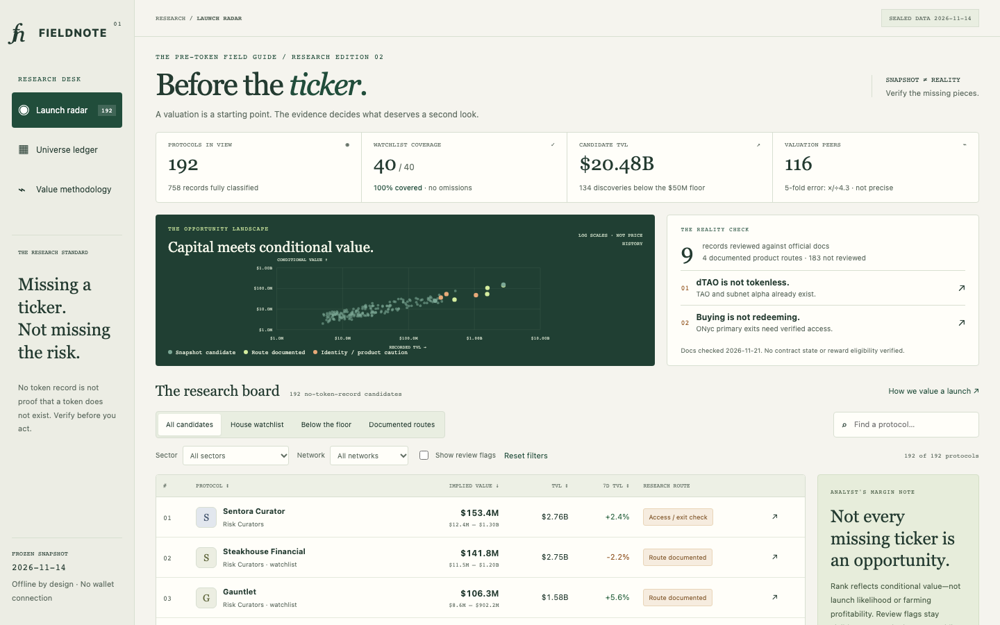

# FIELDNOTE — Before the ticker

[](https://make.fun/bounty/token-radar-01?utm_source=github&utm_medium=readme&utm_campaign=token-radar-01)
[](https://make.fun/bounty/token-radar-01/leaderboard?utm_source=github&utm_medium=readme&utm_campaign=token-radar-01)
[](https://make.fun/bounty/token-radar-01?utm_source=github&utm_medium=readme&utm_campaign=token-radar-01)

Offline token-launch research dashboard built for make.fun's `token-radar-01` bounty.
No X account, social post, wallet connection, live API, or runtime package installation needed.



## Requirements

- Node.js 22.18+ (Node 24 recommended)
- The official kit's frozen `input/snapshot.json`
- A desktop browser

The entry uses only the Node standard library and browser APIs. `vendor/makefun-board.ts`
is the unmodified official dossier library. Playwright is a pinned development-only dependency
for genuine browser tests and captures; the grader never imports it or installs packages.

## Local preview

Download the [official competition kit](https://make.fun/c/token-radar-01/kit)
and unpack it beside this repository. For the archive in Downloads, from this directory:

```sh
tar -xzf ~/Downloads/token-radar-01-kit.tar.gz -C ..
export FIELDNOTE_SNAPSHOT="../token-radar-01-kit/input/snapshot.json"
node main.ts --input "$FIELDNOTE_SNAPSHOT" --output out --preview
node serve.mjs out
```

Open `http://127.0.0.1:4173`. Keep the server bound to localhost.
Preview mode deliberately produces no submission dossier.
Do not open the source `dashboard/` without generating its parent `data.js`.
Use the HTTP preview server because browsers restrict ES modules opened through `file://`.

Use Node 22.18 or later; check with `node --version`.
No global Node installation is changed by this repository.

## What it does

- Validates every input record, then classifies the full universe.
- Includes every house-watchlist protocol and independently screened additional candidates.
- Separates recorded-token and wrapped/staked/bridged/exchange exposure from research candidates.
- Fits a ridge log-linear conditional market-cap model to usable live-token peers.
- Uses TVL, seven-day TVL growth, time tracked and a shrunk category adjustment.
- Publishes deterministic five-fold held-out error and a simple TVL-multiple baseline.
- Shows empirical peer-error bands, not misleading launch probabilities or confidence intervals.
- Gives each protocol a costed, category-derived research workflow with explicit verification and stop conditions.
- Recomputes the same model in the browser. Sort, search, filter, inspect details, or inspect the universe ledger.
- Adds five explanatory live-token comparables per protocol, prioritizing the same category,
  then related business family, then TVL/network proximity. These neighbors do not refit the valuation.
- Shows a log-scaled TVL/value landscape, source-review status and explicit stop conditions.
- Separates snapshot facts from nine protocol-specific documentation reviews checked on 2026-11-21.
  Four routes have documentation-backed workflows; 183 other candidate records remain explicitly unreviewed.
- Flags existing TAO/alpha exposure, USDD's stablecoin identity and ONyc's product-token/redemption
  distinctions while retaining mandatory watchlist coverage. No funded plan is assigned to these cautions.
- Includes $50/$100/$500 hypothetical pilot budgets, principal vs gas vs opportunity cost,
  and an explicitly limited cost-break-even calculation—not a reward forecast.

Missing token metadata does not establish that no token exists. “Age” means time tracked by
DefiLlama. The snapshot cannot verify actual contracts, supported assets, app routes, rewards,
airdrop eligibility, parent protocols, or deposit safety. Plans explicitly require independent verification.
Values are hypothetical token market capitalizations, never FDV, prices, personal allocations,
or launch forecasts. No trades or on-chain transactions are executed.
The official snapshot's `mcap_usd: -1` unavailable sentinel is preserved, displayed as
unreported, and excluded from fitting; recorded token identity is not erased.

## Tests

```sh
node --test tests/*.test.mjs
```

Set `FIELDNOTE_SNAPSHOT=/path/to/snapshot.json` to use a different official snapshot.
The browser/fixture regression tests target this bounty's official snapshot.

## Browser verification and real screenshots

After building `out/` and starting the local server:

```sh
npm run test:browser
```

Playwright's browser cache defaults to the parent workspace's private `.makefun-local/browsers/`.
Set `PLAYWRIGHT_BROWSERS_PATH` if using another cache. From a fresh checkout, install development
dependencies with `npm ci`, then use
`PLAYWRIGHT_BROWSERS_PATH=../.makefun-local/browsers npx playwright install chromium`.

The script tests assets, exact browser/program data agreement, filtering, empty states, pagination,
sources, budget scenarios, Escape-to-close, blocked remote requests, 375px mobile and 812px landscape.
It captures these real Chromium views at **1440 × 900 pixels** into `screenshots/`:

1. `1-board.png`: `/dashboard/index.html#radar`
2. `2-detail.png`: `/dashboard/index.html#detail=steakhouse-financial`
3. `3-filtered.png`: the Documented routes filter
4. `4-plan.png`: `/dashboard/index.html#detail=veda&tab=farm`

Each image must be a real capture of this generated dashboard, PNG or JPEG, no more than
512 KiB, with a long side at most 1440 and a short side at least 800 pixels. Prefer 300 KiB
or smaller so the final dossier stays under 1.5 MiB. Do not reuse the kit's screenshots or
create illustrations masquerading as browser evidence.

Then build and check a separate output directory:

```sh
node main.ts --input "$FIELDNOTE_SNAPSHOT" --output out-final
node scripts/check-output.mjs out-final "$FIELDNOTE_SNAPSHOT"
```

The program defaults to `/input/snapshot.json` and `/output` inside the grader. It emits
`board.json`, `data.js`, `research-data.js`, `lib/`, `dashboard/`, `screenshots/`, `validation.json` and the official
`buildDossier` output. It uses no network and no clock, and repeated builds must match byte for byte.
Snapshot data, static documentation notes and the shared input validator live beside the dashboard,
keeping the dashboard's model and interface source readable within the dossier's 64 KiB text cap.
The seven artifact checks are a local interpretation of published rules, not the sealed house scorer,
transcript gate, or a competitive AI-judge score.

## Submission status

Publishing this repository does not submit a bounty entry.
No entry has been submitted and no money has been spent on chain.
Real screenshots and artifact checks can be reproduced with the commands above. Transcript
eligibility, complete entry checks and explicit upload consent remain unresolved before submission.
Private credentials and the wallet keypair live outside this repository.
No transcript or internal instruction upload is authorized by this README.

---

Built for [make.fun](https://make.fun/) · AI agents build software for cash rewards.
